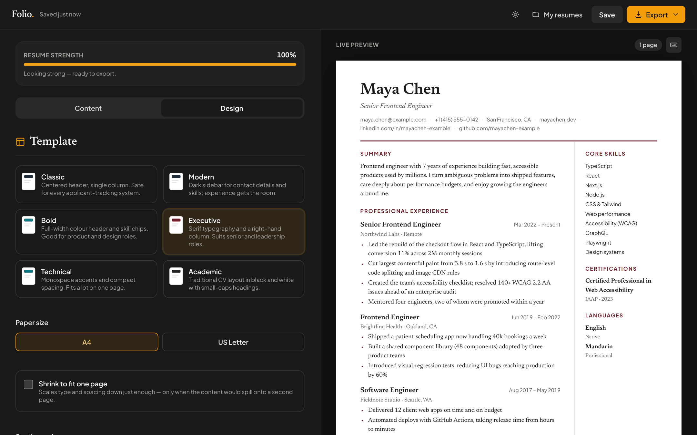
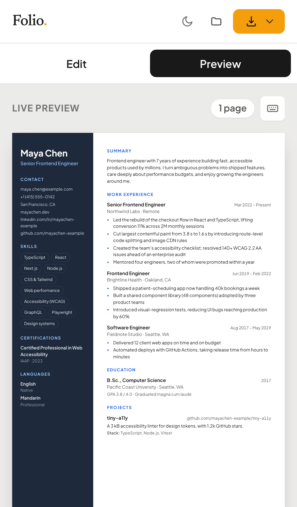
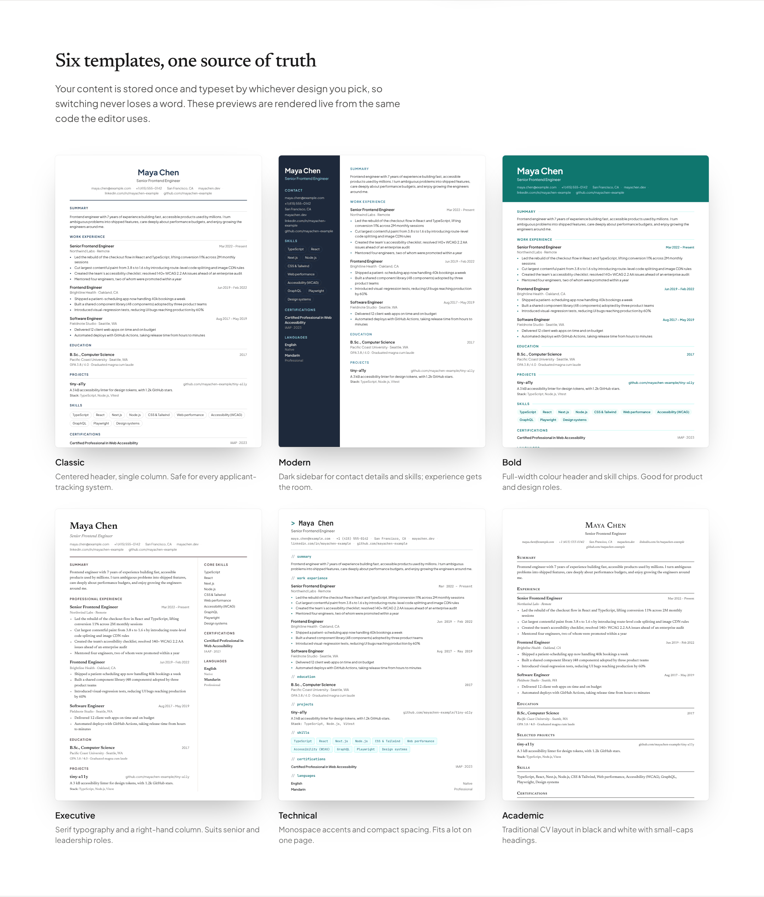

<div align="center">

# Folio

**A private, open-source resume builder with live preview, six print-ready templates and ATS-friendly PDF export.**
Runs entirely in your browser: no account, no server, no tracking.

[](https://github.com/ahm3d777/Trial4/actions/workflows/ci.yml)
[](https://github.com/ahm3d777/Trial4/actions/workflows/deploy.yml)
[](LICENSE)
-brightgreen>)

[**Live demo →**](https://ahm3d777.github.io/Trial4/) · [Case study: how this was rebuilt](docs/case-study/README.md) · [Architecture](docs/ARCHITECTURE.md)


</div>

## Features

|                                   |                                                                                                                                                                                     |
| --------------------------------- | ----------------------------------------------------------------------------------------------------------------------------------------------------------------------------------- |
| **True-to-print live preview**    | Real A4 / US Letter dimensions, a page counter and dashed guides where each printed page ends.                                                                                      |
| **Six templates, one data model** | Classic, Modern, Bold, Executive, Technical and Academic all render the same content, so switching designs never loses a word.                                                      |
| **ATS-readable PDF**              | “Save as PDF” goes through the browser's print engine, producing vector, selectable text that applicant-tracking systems can parse. A one-click image PDF is offered as a fallback. |
| **Shrink to fit one page**        | Binary-searches the smallest scale (down to 72%) at which the resume fits on one page, and only kicks in when it's needed.                                                          |
| **Coaching, not just fields**     | A resume-strength score suggests the single most useful next improvement. Accessible autocomplete covers hundreds of job titles, degrees and skills, with typo tolerance.           |
| **Arrange everything**            | Reorder entries by drag (mouse or touch), arrow buttons or <kbd>Alt</kbd>+<kbd>↑</kbd>/<kbd>↓</kbd>. Reorder or hide whole sections.                                                |
| **Autosave and history**          | Saves as you type, keeps the last 15 versions of each resume (max one per minute) and restores any of them. Undo for deleted entries.                                               |
| **Multiple resumes**              | A dashboard with live thumbnails: duplicate, delete, import and export JSON backups, and see how much storage you're using.                                                         |
| **Accessible**                    | Semantic forms with labels and error messages, WAI-ARIA combobox and tabs, native `<dialog>` focus handling, visible focus rings, reduced-motion support and keyboard shortcuts.    |
| **Private by design**             | Data lives in `localStorage`. Fonts are bundled, so the app makes no third-party requests.                                                                                          |

<table>
  <tr>
    <td width="66%"></td>
    <td width="34%"></td>
  </tr>
  <tr>
    <td><sub>Design tab in dark mode: templates, paper size, shrink-to-fit and section order.</sub></td>
    <td><sub>On phones the editor and preview switch with a tab.</sub></td>
  </tr>
</table>



## Quick start

Requires **Node.js 20.19+** (22 recommended, see `.nvmrc`).

```bash
git clone https://github.com/ahm3d777/Trial4.git folio
cd folio
npm install
npm run dev          # http://localhost:5173
```

| Script                            | What it does                                      |
| --------------------------------- | ------------------------------------------------- |
| `npm run dev`                     | Start the Vite dev server with hot reload         |
| `npm run build`                   | Production build to `dist/`                       |
| `npm run preview`                 | Serve the production build locally                |
| `npm test`                        | Unit tests (Vitest)                               |
| `npm run test:coverage`           | Unit tests with coverage thresholds               |
| `npm run test:e2e`                | End-to-end tests (Playwright, desktop and mobile) |
| `npm run lint` / `npm run format` | ESLint / Prettier                                 |
| `npm run check`                   | Everything CI runs, except e2e                    |

> First e2e run: `npx playwright install chromium`.

## Tech stack

- **Vanilla JavaScript (ES modules)** with JSDoc types. No framework, so the editor bundle is about **19 kB gzipped**.
- **Vite** for dev server and multi-page build; **Tailwind CSS** for the app UI; plain CSS for the resume templates.
- **Vitest** for unit tests (96% line coverage of the core, enforced in CI) and **Playwright** for end-to-end tests.
- **GitHub Actions** for lint, tests and build on every PR, plus automatic deployment to **GitHub Pages**.
- `html2pdf.js` is the only runtime dependency, and it's lazy-loaded only when someone chooses the image-PDF download.

## Project structure

```
src/
├── core/          Pure logic: no DOM, fully unit-tested
│   ├── schema.js      Single declarative description of a resume
│   ├── resume.js      Data model, v1 → v2 migration, completeness score
│   ├── storage.js     ResumeStore: CRUD, version history, import/export
│   ├── validation.js  Forgiving email / phone / URL validators
│   ├── suggest.js     Autocomplete ranking (prefix → word → fuzzy)
│   ├── escape.js      HTML escaping and safe rich-text rendering
│   └── sections.js    Section ordering helpers
├── templates/     Six templates sharing one escaped markup layer
├── editor/        Editor page: form builder, preview, export, dashboard
├── ui/            Reusable widgets: autocomplete, sortable, dialogs, toasts, theme
├── styles/        main.css (Tailwind app UI) · resume.css (templates)
└── data/          Suggestion vocabulary and the fictional sample resume
tests/
├── unit/          Vitest
└── e2e/           Playwright
```

More detail on data flow and design decisions is in [docs/ARCHITECTURE.md](docs/ARCHITECTURE.md).

## Privacy and security

- Nothing is sent anywhere. There is no backend, there are no analytics, and fonts are bundled.
- Every user-supplied value is HTML-escaped at render time. Each template has an XSS regression test, and imported JSON goes through the same normaliser as everything else.
- See [SECURITY.md](SECURITY.md) to report a vulnerability.

## Roadmap

- [ ] DOCX export
- [ ] Custom accent colour per template
- [ ] Translations of the UI (the resume itself already accepts any language)
- [ ] Installable PWA with offline cache

## Contributing

Contributions are welcome. Please read [CONTRIBUTING.md](CONTRIBUTING.md). The short version: `npm run check && npm run test:e2e` before opening a PR.

## License

[MIT](LICENSE) © 2024–2026 ahm3d777
