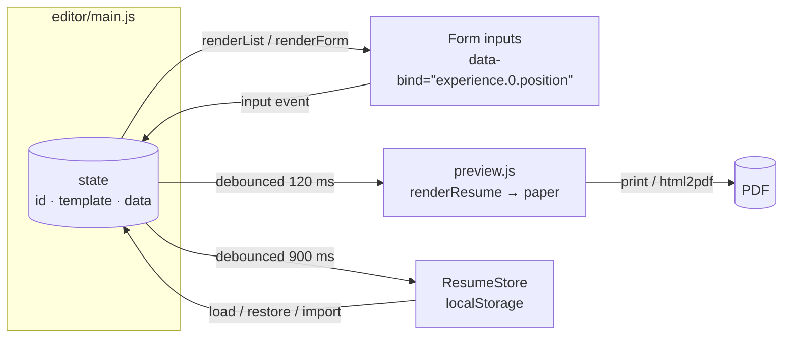

# Architecture

Folio is a static, multi-page app (`index.html` for the landing page, `editor.html` for the editor) built with Vite. There is no backend.

## Data flow



1. **One state object.** The form is rendered _from_ state, and every input carries a `data-bind` path. One delegated `input` listener writes the value back. The DOM is never read to reconstruct data, which is what v1 did, and that was why it had two diverging `getFormData` implementations.
2. **Structural changes re-render.** Adding, removing or moving an entry mutates the array in state and re-renders just that section's list. Typing doesn't re-render, so focus and caret are never disturbed.
3. **Pure rendering.** `renderResume(templateId, data)` is a pure function from data to an HTML string. Every value passes through `escapeHTML` or `renderRichText`.
4. **Persistence is debounced** and flushed on `visibilitychange` and `pagehide`, so closing the tab never loses the last edits.

## Modules

| Layer        | Depends on       | Notes                                                               |
| ------------ | ---------------- | ------------------------------------------------------------------- |
| `core/`      | nothing (no DOM) | Unit-tested. `ResumeStore` takes an injectable `Storage` and clock. |
| `templates/` | `core/`          | Pure string rendering. One shared markup layer, six layouts.        |
| `ui/`        | `core/`          | Generic widgets: autocomplete, sortable, dialog, toast, theme.      |
| `editor/`    | everything       | Page wiring. Covered by Playwright.                                 |

## Key decisions

**Schema-driven forms.** `core/schema.js` describes every field once: label, type, placeholder, hint, autocomplete dataset, max length. The form builder, the normaliser (`normalizeResume`), the empty-entry check and the completeness score all read from it. Adding a field is a one-line change plus rendering it in a template.

**Escape on output, store raw.** v1 escaped values _before_ saving, which double-encoded `&` on reload and still left the preview unsafe, because the preview read from the DOM. v2 stores exactly what the user typed and escapes at the single point where HTML strings are built. `normalizeResume` detects v1 data (no `version` field) and unescapes it once.

**Two PDF paths.**

- _Save as PDF_ clones the paper into `#print-root`, sets `@page { size; margin: 0 }` and calls `window.print()`. The result is vector text that parsers can read. `box-decoration-break: clone` repeats the page padding on continuation pages. This also handles the browser's own <kbd>Ctrl</kbd>+<kbd>P</kbd> via `beforeprint`.
- _Quick download_ lazy-loads `html2pdf.js` (about 265 kB gzipped, never part of the initial bundle) and renders an _unscaled_ off-screen clone, so the preview's zoom can't leak into the file.

**A scalable unit for shrink-to-fit.** Every size in `resume.css` is `calc(N * var(--u))`, with `--u: 1px` by default. Fitting to one page is a binary search over `--u` from 1px down to 0.72px (seven iterations, about 1% precision). Because only one custom property changes, font sizes, spacing, borders and sidebar widths all scale together, and it works the same in screen, print and html2canvas.

**Pointer events instead of HTML5 drag-and-drop.** HTML5 DnD doesn't fire on touch devices. `ui/sortable.js` uses pointer capture, picks the drop target by nearest centre (so it works for the two-column skills grid too) and delegates from the form root, so re-rendered lists need no re-binding. Keyboard users get up/down buttons and <kbd>Alt</kbd>+<kbd>↑</kbd>/<kbd>↓</kbd>.

**No framework.** The state is small and the interactions are form-centric. A framework would multiply the bundle size by 5 to 10 for little gain here. The trade-off is some manual DOM wiring in `editor/main.js`, kept manageable by the strict separation above.

## Storage format

```jsonc
// localStorage["resumes"]: array of records (key kept from v1 for compatibility)
{
  "id": "resume_…",
  "title": "Maya Chen",
  "template": "modern",
  "createdAt": "2026-10-12T10:00:00.000Z",
  "updatedAt": "2026-10-12T10:05:00.000Z",
  "data": {
    "version": 2,
    "fullName": "…",
    "headline": "…",
    "email": "…" /* … */,
    "experience": [{ "position": "…", "company": "…", "duration": "…", "description": "- bullet\n- bullet" }],
    "skills": [{ "name": "TypeScript" }],
    "sectionSettings": { "order": ["summary", "experience", "…"], "hidden": [] },
    "compactMode": false,
    "paper": "a4",
  },
}
// localStorage["resume_history_<id>"]: up to 15 snapshots, at least 60 s apart
```
