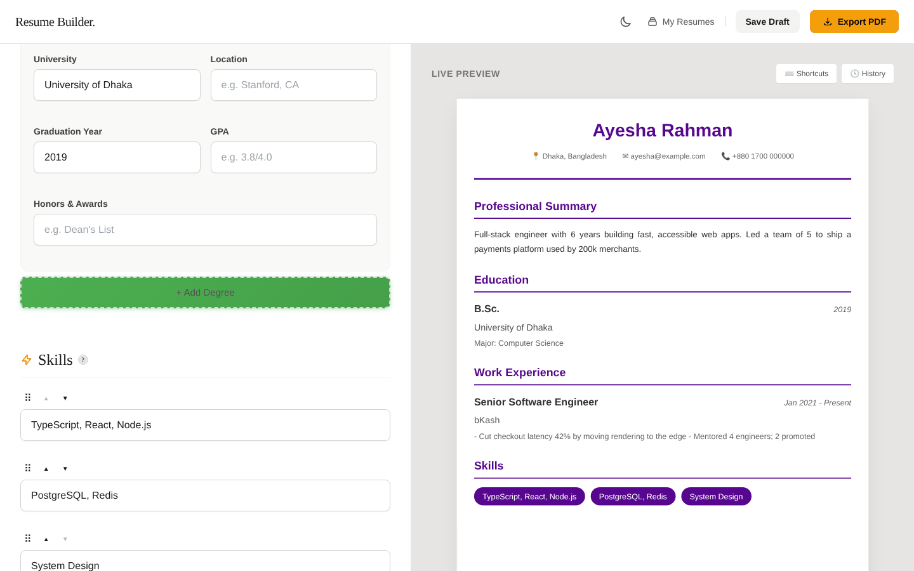
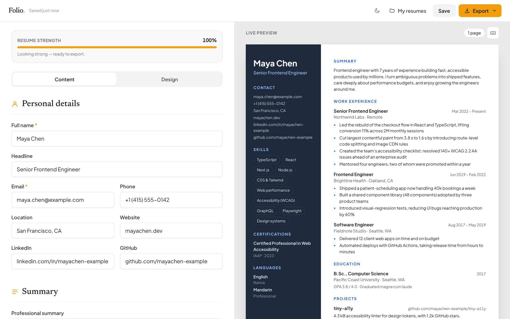

# Case study: from "Trial4" to Folio

This repository started as an experiment, a resume builder assembled over several rounds of quick AI-assisted edits. It worked in places, but it wasn't something you could hand to a client or a hiring manager. This document records what was wrong, what changed and why. The original code is preserved at the [`legacy-snapshot`](https://github.com/ahm3d777/Trial4/tree/legacy-snapshot) tag.

## At a glance

|                      | Before (v1)                                                                                                        | After (v2)                                                                |
| -------------------- | ------------------------------------------------------------------------------------------------------------------ | ------------------------------------------------------------------------- |
| Files in repo        | 46, including 9 `* copy` duplicates and 6 auto-generated status reports                                            | Every file has a purpose                                                  |
| Repo size            | 13.4 MB (two 6 MB unused photos)                                                                                   | about 1.7 MB, mostly documentation screenshots                            |
| Largest source file  | `resume-builder.js`, 2,951 lines in one IIFE                                                                       | `editor/main.js`, about 720 lines; every other logic module under 250     |
| Working templates    | 3 of 6 (templates 4 to 6 had no CSS)                                                                               | 6 of 6, each tested                                                       |
| Security             | Stored XSS through any field or imported JSON                                                                      | Escaped at render time, with a regression test per template               |
| PDF                  | Screenshot of the scaled preview; text not machine-readable                                                        | Vector text via print engine, plus an optional image PDF                  |
| Tests                | None (one "TESTING_CHECKLIST.md")                                                                                  | 103 unit tests, 17 Playwright scenarios on desktop and mobile             |
| Tooling              | `vite build` silently skipped all app scripts                                                                      | ESLint, Prettier, coverage thresholds, CI, auto-deploy                    |
| Docs                 | Out-of-date README (listed 3 of 6 templates; said "no build step, just open `index.html`", which no longer worked) | README, architecture notes, changelog, contributing and security policies |
| Third-party requests | Google Fonts, cdnjs                                                                                                | None                                                                      |

## Before → after

<table>
  <tr><th>Before</th><th>After</th></tr>
  <tr>
    <td></td>
    <td></td>
  </tr>
  <tr>
    <td>Leftover v0 styles (the green "Add" button) fighting the Tailwind redesign; bullets typed as "-" rendered as one run-on line.</td>
    <td>One coherent design system, real bullet lists, page counter, resume-strength coaching.</td>
  </tr>
</table>

## What the audit found

### Bugs users could hit

1. **Stored XSS.** `templates.js` built the preview with template literals and assigned it to `innerHTML` without escaping, e.g. `<h3>${exp.position}</h3>`. Typing `` in any field executed it. Worse, the **Import JSON** feature made it shareable: anyone could send a "resume backup" that ran code in the recipient's browser.
2. **Half the templates were unstyled.** Executive, Technical and Academic generated markup with classes like `.executive-layout`, but no stylesheet ever defined them.
3. **18 CSS custom properties were never defined** (`--bg-surface`, `--text-label`, …). That left the autocomplete dropdown transparent and the dashboard and history modal mostly unstyled.
4. **Data corruption on reload.** Values were HTML-escaped _before_ saving, so "R&D" came back as "R&amp;D", and got worse with every save.
5. **Autosave silently skipped** whenever the form was invalid. A typo in the email field meant nothing else was saved.
6. **PDF export captured the zoomed preview.** The preview was CSS-scaled to fit the pane, and html2pdf captured it as-is. The PDF was also an image, which applicant-tracking systems can't read, despite the "ATS friendly" claim on the landing page.
7. **Print printed the whole app.** The print stylesheet hid elements by IDs that no longer existed.
8. **Theme bugs.** The landing page never loaded the toggle script, and a `prefers-color-scheme` rule forced a near-black background even after the user chose light mode.
9. **The production build was broken.** Scripts were plain `<script src>` tags in `public/`, so Vite copied but never bundled them, and Tailwind's `content` globs didn't include them, so classes used only in JS were purged.

### Maintainability problems

- Two independent `getFormData()` implementations (preview vs. save) that disagreed, e.g. `lang.language` vs. `lang.name`.
- The first entry in each section used `id`s while added entries used `name="x[]"`, so every reader needed two code paths.
- 1,900 lines of CSS, roughly half of it for markup that no longer existed (login forms, `.popup`, `#feature`).
- Hard-coded limits (`for (let i = 1; i <= 10; i++) getElementById('skill' + i)`).

## How it was rebuilt

The [architecture notes](../ARCHITECTURE.md) have the detail. In short:

- **A single schema** (`src/core/schema.js`) drives the form, data normalisation and scoring.
- **A single state object.** The DOM is a view of state, never the source of it.
- **A pure core** (`src/core`) with no DOM access: unit-tested to 96% line coverage, with the threshold enforced in CI.
- **Templates as pure functions** from data to HTML, sharing one escaped markup layer and differing only in layout and CSS.
- **Backward compatibility.** v1 resumes in `localStorage` are migrated automatically (unescaped, skills converted, template IDs mapped), the old `Resume-Editor.html` URL redirects, and both are covered by an e2e test.

## Product polish that came with it

A name and visual identity, a headline field, A4 and Letter paper, page-break guides, shrink-to-fit that scales by exactly what's needed, a resume-strength meter that suggests the next improvement, undo, touch drag-and-drop, keyboard reordering, live thumbnails, a landing page whose template gallery is rendered by the real template code, and self-hosted fonts so the privacy promise ("nothing leaves your browser") is true.

## Commit trail

The rebuild is a short series of [Conventional Commits](https://www.conventionalcommits.org/) on top of the original history, so `git log legacy-snapshot..main` reads as the story above:

1. `chore:` remove duplicates, stale reports and unused assets
2. `refactor!:` rebuild as Folio, a modular, schema-driven app
3. `test:` unit and end-to-end suites
4. `ci:` CI, Pages deployment, Dependabot
5. `docs:` README, architecture, case study, policies
